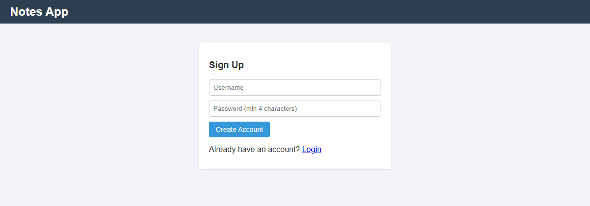
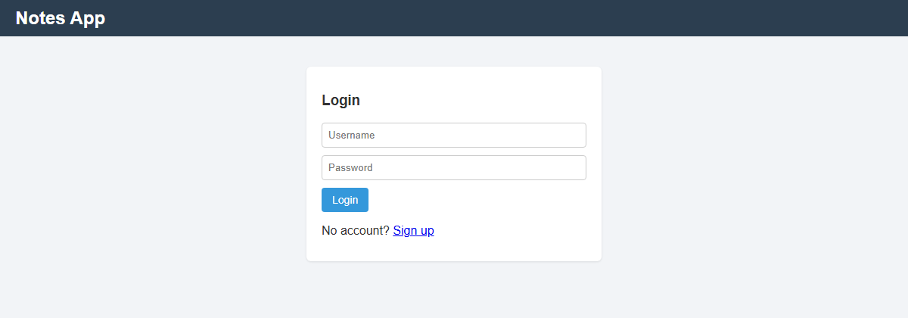
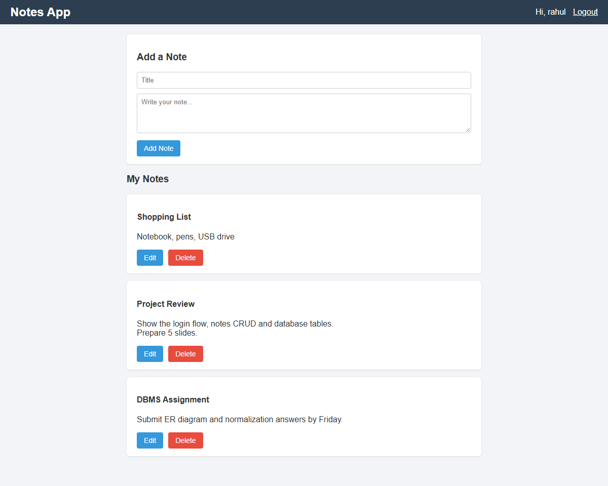
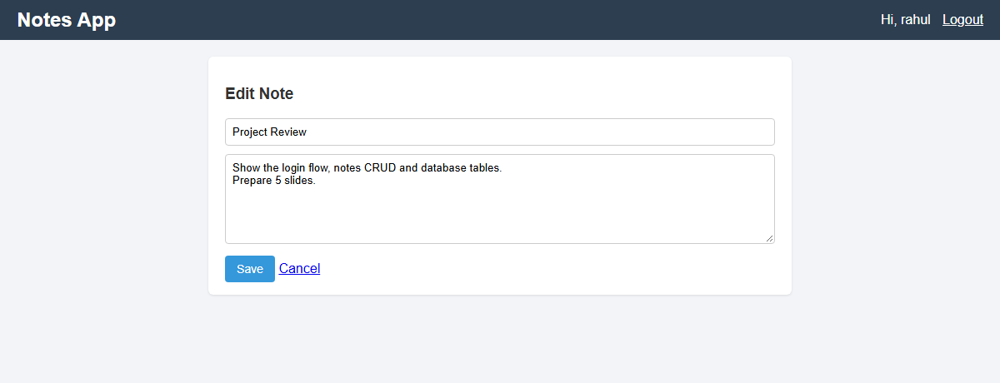
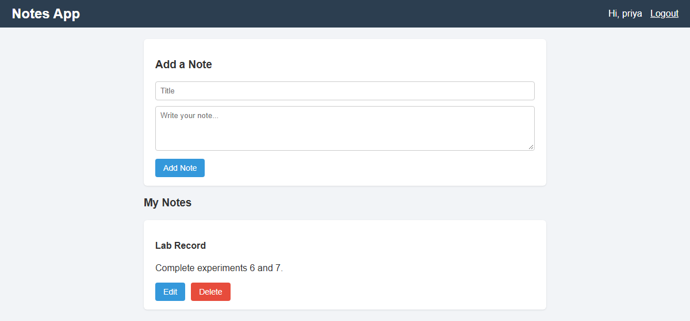
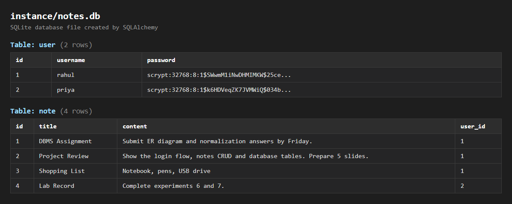

# Notes App

A simple notes app made with Python Flask and SQLAlchemy.
Users can sign up, log in, and add, edit and delete their own notes.

## Tech Stack

| Part | Technology | Used for |
|------|------------|----------|
| Backend | Python, Flask | Routes, forms, page rendering |
| Database | SQLite | Stores users and notes in `instance/notes.db` |
| ORM | SQLAlchemy (Flask-SQLAlchemy) | Creating tables and running queries using Python classes |
| Authentication | PyJWT | Login token stored in an httpOnly cookie |
| Password security | Werkzeug | Hashing and checking passwords |
| Frontend | HTML (Jinja templates), CSS | Pages and styling |

## Features

- Sign up, login and logout
- Add, view, edit and delete notes
- Each user can see only their own notes
- Passwords are stored as hashes

## Screenshots

### Sign Up


### Login


### My Notes (add, edit, delete)


### Edit Note


### Another user only sees their own notes
When `priya` logs in, only the "Lab Record" note is shown. Rahul's notes are not visible.



### Data stored in notes.db
- The `user` table stores the password as a hash, not the real password.
- In the `note` table, `user_id` shows which user owns each note: notes 1 to 3 belong to rahul (id 1), and note 4 belongs to priya (id 2).



## Project Workflow

```
Sign Up  →  Login  →  JWT token saved in cookie  →  Notes page  →  Add / Edit / Delete  →  Logout
```

1. **Sign Up**: the user enters a username and password. The password is hashed and saved in the `user` table.
2. **Login**: the server checks the password hash. If it is correct, it creates a JWT token with the user's id and saves it in an httpOnly cookie. The token is valid for 1 day.
3. **Opening the notes page**: the server reads the token from the cookie and checks it. If the token is missing, wrong or expired, the user is sent back to the login page.
4. **Add a note**: the note is saved in the `note` table with the logged in user's id.
5. **View notes**: the app loads only notes where `user_id` matches the logged in user.
6. **Edit / Delete**: the app finds the note using both the note id and the user id. If the note belongs to someone else, it shows a 404 error.
7. **Logout**: the token cookie is deleted.

## Database Tables

**user**

| Column | Type | Details |
|--------|------|---------|
| id | Integer | Primary key |
| username | String | Unique |
| password | String | Hashed password |

**note**

| Column | Type | Details |
|--------|------|---------|
| id | Integer | Primary key |
| title | String | Note title |
| content | Text | Note text |
| user_id | Integer | Foreign key to `user.id` |

## Project Structure

```
notes-app/
  app.py              routes, database tables and JWT login
  requirements.txt
  templates/
    base.html
    login.html
    signup.html
    notes.html
    edit.html
  static/
    style.css
  screenshots/
```

## How to Run the Project

You need **Python 3** and **Git** installed.

**1. Clone the project**

```
git clone https://github.com/<your-username>/notes-app.git
cd notes-app
```

**2. Create a virtual environment (optional but recommended)**

Windows:
```
python -m venv venv
venv\Scripts\activate
```

Mac / Linux:
```
python3 -m venv venv
source venv/bin/activate
```

**3. Install the requirements**

```
pip install -r requirements.txt
```

**4. Run the app**

```
python app.py
```

**5. Open in browser**

Go to http://127.0.0.1:5000. Sign up, then log in to start adding notes.

The database file `instance/notes.db` is created automatically on the first run.

## Push to GitHub

First create an empty repository named `notes-app` on github.com. Then run these commands inside the project folder:

```
git init
git add .
git commit -m "Notes app using Flask and SQLAlchemy"
git branch -M main
git remote add origin https://github.com/<your-username>/notes-app.git
git push -u origin main
```

To push changes later:

```
git add .
git commit -m "your message"
git push
```
